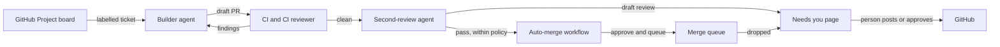

*Portfolio of Yuanzhe Lu. The site is `index.html`, served by GitHub Pages; below is the same case study as text.*

# From ticket to merged pull request, with a person only where judgement is needed

**An automated workflow that takes tickets from a GitHub Project board, has Claude agents build and review
them, and merges what passes its rules. People see one page: what needs them.** In its first twelve
days on a production codebase it opened 46 pull requests from 54 tickets and 36 of them merged, 11
approved and queued by the workflow itself.

*Built with TypeScript, the Claude Agent SDK, GitHub GraphQL and REST, GitHub Actions
and Docker.*

---

## The problem

A small product team had more well-specified tickets than hands, and a review step that was already
the bottleneck. Coding agents could write the code. The question was how to let them work through a
board unattended without giving up control: who decides what gets built, what gets posted on GitHub
in the team's name, and what gets merged.

## What it does

1. **Builder.** Takes a labelled ticket from the board, works on its own branch in its own workspace,
   runs the tests, reviews its own diff, and opens a draft pull request. When it needs a decision it
   asks on the dashboard and waits, instead of guessing.
2. **CI and a CI reviewer.** Medium and worse findings go back to the builder before any more
   expensive review is spent on the change.
3. **Second review.** An agent checks the change against the ticket's acceptance criteria, the
   repository's rules and its high-risk paths, and saves its review as a **draft**. On the builder's
   own PRs a review that asks for changes goes out at once, so the builder can start fixing.
4. **A person**, on one page, sees only what waits on them: drafts to post or discard, questions from
   the builder, PRs that need a decision.
5. **Auto-merge.** A pass from the second review can be approved and queued by a separate GitHub App
   workflow, but only if every rule holds: the CI reviewer holds nothing open, no conflicts, no
   unresolved threads, no protected paths, size limits. Anything else comes back to a person, with
   the reason.

## Decisions worth explaining

**A person decides what goes out on other people's work.** A review of a teammate's PR is saved as a
draft, and posting it is a person's click. Only reviews of the builder's own PRs that ask for changes
go out by rule: waiting for a click there only delayed the fix, and 46 of 105 drafts on the
builder's PRs went stale while they waited. The builder pushes code and opens PRs, but cannot approve, merge or
post a review.

**Cheap checks before expensive ones.** The second review only starts once CI has passed and the CI
reviewer has nothing above low open. A PR the CI reviewer flags goes straight back to the builder.
Low findings are left to the second review to weigh: when they sent PRs back too, 38 of 111 rounds
went back for lows alone. From the second round on, the review reads only what changed since its last
posted review, plus the high-risk paths in full.

**Waiting lists are worked out, not accumulated.** Needs you used to be a list of events, each closed
only by the step that dealt with it, and 26 of 42 waiting items had gone out of date. It is now
computed from where every PR stands: what will never need a person is closed with the reason, what
waits on something else (a PR stacked on another, one back with the builder) is held with one line
saying what it waits on, and the rest is the list.

**Auto-merge as policy, not as trust.** It lives in its own repository with its own GitHub App, so its
rules are versioned and reviewed like code, and a single repository variable turns it off. Hard rules
(protected paths, open findings, recent reverts) cannot be overridden from the dashboard; soft ones
(size, labels) can, by a person, one PR at a time.

**The agent's container holds no credentials.** Each agent run, each install script and each git
command touching a workspace run in a throwaway container:

- *GitHub.* The token stays on the host. A workspace's `origin` is a read-only mirror. To push, the
  container hands the host a git bundle on stdout; the host imports it without force, checks its
  objects, and pushes. Host git never runs inside a workspace, because it would obey whatever the
  agent wrote into `.git/config`.
- *Model API.* The API key stays in a small proxy on the host. The agent gets a token valid only for
  its run and only for the model endpoints, revoked when the run ends.
- *Network.* A firewall set up as root, before root and every capability are dropped for good,
  closes all private addresses: the host, the local network, other containers, cloud metadata.

Each of these is tested against real Docker with a control: the attack is shown to work without the
sandbox, then shown to fail with it.

**One codebase for any repository.** Everything particular to a project (repository, board, column
names, install steps, review rules) moved into one project file. The refactor was proven safe by
loading the production configuration before and after: identical, and every rendered prompt identical
byte for byte. `init` now sets up a new repository and board in one command.

## Results

First twelve days on a production TypeScript monorepo:

| | |
|---|---|
| Tickets worked by the builder | 54 |
| Pull requests opened / merged | 46 / 36 (none closed unmerged) |
| Merged with approval from the auto-merge workflow | 11 |
| Second reviews saved as drafts | 131: 61 pass, 37 changes, 33 need a person |
| Questions the builder asked instead of guessing | 25 |
| Median builder run / review run | 27 min / 12 min |
| Median time from PR opened to merged | 21 hours |

On a fresh demo repository, a new ticket went from the board to a passing PR with a saved review in
about five and a half minutes, for under a dollar at API prices.

The service is about 13,000 lines of TypeScript with 8,300 lines of tests, and over 440 unit tests
plus 14 end-to-end sandbox tests against real Docker.

## What went wrong, and what changed because of it

- **PRs vanished from the merge queue without anyone noticing.** GitHub records the removal only on
  the PR's timeline. The workflow now reads it and puts a card in front of a person, saying
  whether the build failed or the branch conflicted. The first one caught a PR that had silently
  failed twice.
- **A "daily" spending limit that was not daily.** It counted from process start, reset on restart,
  and each daemon counted alone. It now sums the day's runs from the run ledger.
- **The reviewer would have waited forever on a new project**, for a CI reviewer only the first team
  ran. Found by running a brand-new repository end to end; now optional.
- **A path check the proxy could be talked out of.** `/v1/messages/../files` passed the allow-list
  and was normalised into something else on the way out. Caught in self-review; the check now runs on
  the path as sent.

## An AI manager, on probation

The next layer takes decisions off the person's list. A model reads each item that waits on them, a
review draft or a builder's question, and writes down what it would do, how sure it is and why. It
acts on none of it yet. Its calls are set against what the person then did, by kind of decision, and
a kind is handed over only once the two agree. Two details make that number honest: items a rule
closed before the person decided are left out of it, and a few gates stay with a person whatever the
score, such as approving a teammate's PR. An item whose call keeps failing is tried three times and
then left alone, so a broken one cannot hold up the rest or be paid for at every poll.

## What is next

- Handing over the first kinds of decisions the manager agrees on.
- A GitHub App identity for the builder, so its PRs and a person's approvals come from different
  accounts.
- A full model run inside the sandbox with an API key. So far the sandbox is verified up to the agent
  starting and reaching the model through the proxy.
- An egress allow-list, so code in a run cannot send what it reads to arbitrary public addresses.
